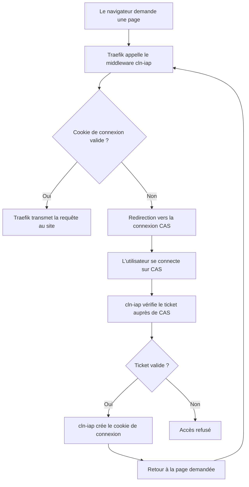

# cln-iap

**cln-iap** est un Identity-Aware Proxy (IAP) minimaliste en Go, destiné à protéger les applications Web derrière Traefik en imposant une authentification préalable. Il agit comme un « VPN applicatif » : seuls les utilisateurs authentifiés peuvent accéder aux applications, directement depuis leur navigateur, sans installer de client VPN ni ouvrir un accès au réseau interne.

## Genèse et objectif

Une application peut disposer de son propre mécanisme d'authentification tout en exposant des fonctionnalités vulnérables avant la connexion. cln-iap est né de l'idée de placer une barrière d'authentification en amont, au niveau du reverse proxy.

L'objectif est de réduire l'exposition des applications aux requêtes anonymes, sans modifier leur code. Cette protection complète les contrôles d'accès des applications et ne remplace pas leurs mises à jour de sécurité.

## Fonctionnement

L’intégration se fait avec un **middleware ForwardAuth** : avant de laisser passer une requête, Traefik demande à cln-iap si l’utilisateur est connecté. Sinon, celui-ci est redirigé vers CAS.

La redirection concerne les requêtes GET/HEAD. Sans cookie valide, les autres méthodes reçoivent une réponse `401`.

## Installation

L’image utilisée est `ghcr.io/eskan/cln-iap:latest`. Choisir votre environnement : chaque guide couvre le secret, le démarrage de cln-iap, les routes de connexion et l’ajout du middleware.

L’image est construite pour **amd64 et arm64** par [GitHub Actions](docs/image.md).

- [Kubernetes](docs/kube.md)
- [Docker Compose](docs/compose.md)
- [Docker Swarm](docs/swarm.md)
- [Nomad](docs/nomad.md)

Les exemples supposent Traefik et CAS disponibles. Consulter les [variables et prérequis communs](docs/configuration.md). Pour une configuration du middleware par fichier, voir [Traefik YAML](docs/traefik.md).

cln-iap fonctionne sans base de données. Il ne remplace pas l’authentification propre aux sites et ne leur transmet pas l’identité de l’utilisateur.
