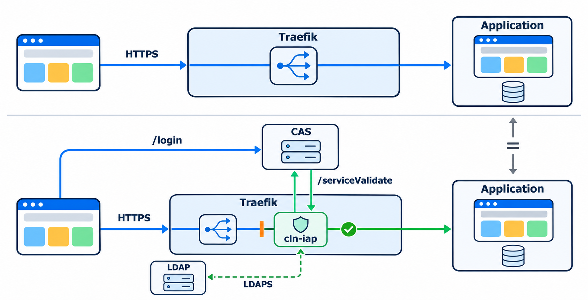

# cln-iap (séléniap)

Compte tenu du climat actuel autour des failles de sécurité, il paraît essentiel de restreindre la surface d’attaque de nos applications. L’une des pistes envisagées est un Identity Aware Proxy : il vise à garantir l’authentification de l’utilisateur avant tout accès. On peut le voir comme un VPN applicatif. **Aucune modifications des applications n'est nécessaire.** Il ne remplace pas l’authentification propre à l’application, et son fonctionnement reste transparent pour l’utilisateur.
Celui-ci se connecte sur CAS, puis accède à la page demandée. Sa session est partagée entre les sites autorisés du même domaine.
Chaque application peut restreindre l’accès à ses propres utilisateurs. cln-iap ne se substitue pas aux contrôles d’accès de l’application et ne lui transmet pas l’identité de l’utilisateur.



**cln-iap** protège les applications Web derrière **Traefik 3** avec une authentification CAS. L’utilisateur se connecte une fois et partage sa session entre les sites autorisés du même domaine. Chaque application définit ses restrictions par login et, facultativement, par attribut LDAP.

L’administrateur conserve la configuration commune et les secrets ; les responsables d’applications renseignent seulement leurs règles d’accès. Le middleware ne transmet pas l’identité à l’application et ne remplace pas ses propres contrôles d’accès.

## Prérequis

- Traefik 3 terminant directement les connexions HTTPS ; version validée : **3.7.17**.
- Un CAS accessible en HTTPS avec `/login` et `/serviceValidate`.
- Des sites sous un domaine commun, par exemple `app.example.org` et `outils.example.org`.

## Installation administrateur

L’administrateur installe le plugin dans Traefik, lui indique le serveur CAS et les sites à protéger, puis fournit le secret commun aux sessions. Les applications n’ont pas besoin de recevoir ces paramètres ni ce secret.

### Charger le plugin

Le répertoire du plugin contient les fichiers nécessaires à son chargement par Traefik. Le monter en lecture seule dans Traefik à l’emplacement suivant :

```text
/plugins-local/src/github.com/eskan/cln-iap
```

Activer le plugin dans la configuration statique :

```yaml
experimental:
  localPlugins:
    cln-iap:
      moduleName: github.com/eskan/cln-iap
```

### Fournir le secret

Ce secret protège les sessions CAS et les autorisations LDAP. Tous les réplicas Traefik doivent utiliser le même fichier, accessible uniquement à l’administrateur et à Traefik.

Créer le fichier `cln_iap_jwt` :

```sh
umask 077
openssl rand -hex 32 > cln_iap_jwt
```

Monter ce fichier en lecture seule à `/run/secrets/cln_iap_jwt` dans le conteneur Traefik ; les guides de déploiement ci-dessous donnent le montage adapté à chaque environnement.

### Définir les paramètres communs

Les variables suivantes indiquent où se connecter à CAS, quels sites protéger et combien de temps conserver la session. Ici, `app.example.org` et `outils.example.org` partagent une session sur `example.org` pendant quatre heures.

Définir ces variables sur Traefik, puis le redémarrer :

```text
CLN_IAP_CAS_URL=https://cas.example.org/cas
CLN_IAP_COOKIE_DOMAIN=example.org
CLN_IAP_ALLOWED_HOSTS=app.example.org,outils.example.org
CLN_IAP_JWT_SECRET_FILE=/run/secrets/cln_iap_jwt
CLN_IAP_JWT_TTL=4h
CLN_IAP_LOG_LEVEL=info
```

Consulter la [référence des paramètres](docs/configuration.md) pour les options et les changements de configuration.

## Autoriser les retours dans CAS

Après la connexion, CAS renvoie le navigateur vers `/__cln_iap/callback` sur le site demandé pour terminer l’authentification. Ces adresses de retour doivent être autorisées dans le registre des services CAS.

Pour les deux sites de l’exemple, utiliser ce motif si le registre accepte les expressions régulières :

```text
^https://(app|outils)\.example\.org/__cln_iap/callback\?state=[A-Za-z0-9_-]{43}$
```

Le paramètre `state` varie à chaque connexion. Le certificat HTTPS de CAS doit être reconnu par Traefik ; installer l’autorité de confiance si elle est privée.

## Protéger une application

Le middleware porte les règles d’accès ; le routeur Traefik détermine les adresses auxquelles elles s’appliquent. Déclarer un middleware propre à l’application et l’attacher à son routeur HTTPS existant. Ici, `mon-app-iap` limite l’accès au routeur `mon-app` aux utilisateurs CAS `alice` et `bob` :

```yaml
labels:
  - "traefik.http.middlewares.mon-app-iap.plugin.cln-iap.allowedLogins=alice,bob"
  - "traefik.http.routers.mon-app.middlewares=mon-app-iap"
```

Un `allowedLogins` vide autorise tous les utilisateurs CAS. Pour une restriction supplémentaire, suivre le [guide LDAP](docs/ldap.md).

Placer cln-iap avant les middlewares de réécriture de chemin. Le routeur doit couvrir `/__cln_iap/callback`, y compris pour une application sous un préfixe : voir l’[exemple Traefik](docs/traefik.md).

## Guides de déploiement

- [Docker Compose](docs/compose.md)
- [Docker Swarm](docs/swarm.md)
- [Kubernetes](docs/kube.md)
- [Nomad](docs/nomad.md)
- [Fichier dynamique Traefik](docs/traefik.md)
- [Performances](docs/benchmark.md)
