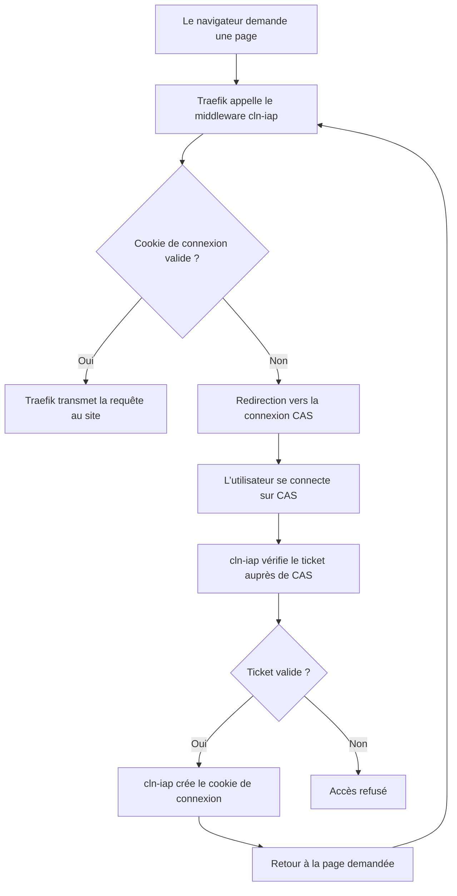

# cln-iap ( middleware traefik )

**cln-iap** (Séléniap) est un _Identity-Aware Proxy_ (IAP) qui protège les applications Web en imposant une authentification préalable, transparente pour l'utilisateur. À la manière d'un VPN applicatif, il permet d'accéder aux services depuis un simple navigateur, sans client VPN ni exposition du réseau interne.

Le projet est né d'un constat : même lorsqu'une application dispose de son propre système d'authentification, elle peut présenter des vulnérabilités exploitables avant toute connexion. **cln-iap place donc une barrière d'authentification en amont, au niveau du reverse proxy**, afin de réduire l'exposition aux requêtes anonymes sans modifier les applications. Cette protection supplémentaire ne se substitue ni à leurs contrôles d'accès ni à leurs mises à jour de sécurité.

## Fonctionnement

L’intégration se fait avec un **middleware ForwardAuth** : avant de laisser passer une requête, Traefik demande à cln-iap si l’utilisateur est connecté. Sinon, celui-ci est redirigé vers CAS.

La redirection concerne les requêtes GET/HEAD. Sans cookie valide, les autres méthodes reçoivent une réponse `401`.

## Intégration

Configurer les [variables de cln-iap](docs/configuration.md), puis ajouter le middleware selon votre environnement :

- [Kubernetes](docs/kube.md)
- [Docker Compose](docs/compose.md)
- [Docker Swarm](docs/swarm.md)
- [Nomad](docs/nomad.md)
- [Traefik par fichier YAML](docs/traefik.md)

Ces guides concernent une installation Traefik existante et un service cln-iap déjà démarré. Ils montrent comment déclarer le middleware et l’ajouter à un routeur existant.

cln-iap fonctionne sans base de données. Il ne remplace pas l’authentification propre aux sites et ne leur transmet pas l’identité de l’utilisateur.
